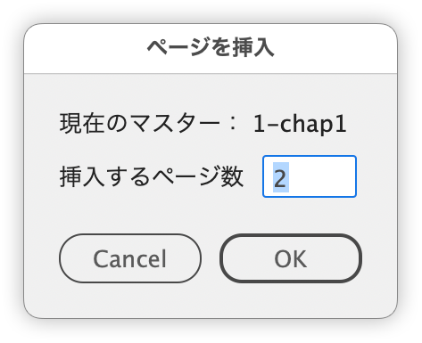
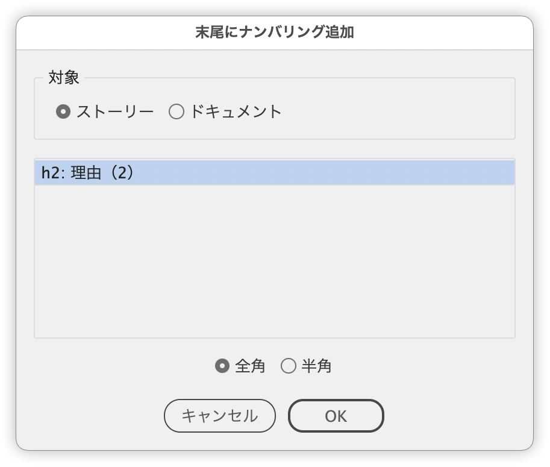
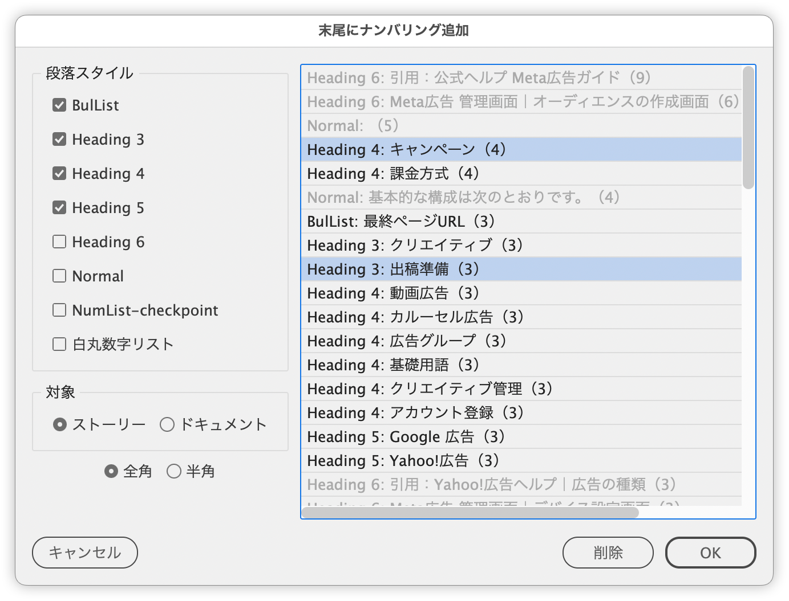
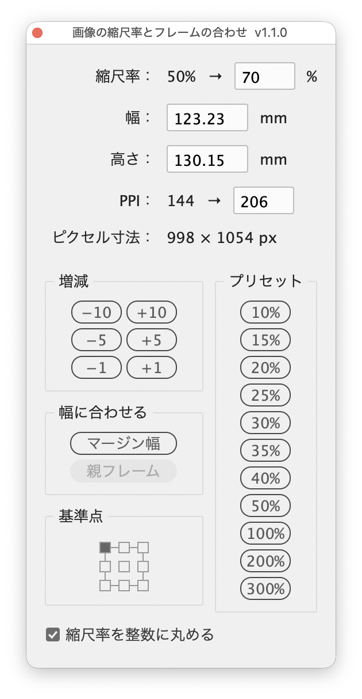

# Adobe InDesign Scripts

アップデート情報（新規／アップデート）は、noteが一番早いです。

[DTP Transit 別館｜note](https://note.com/dtp_tranist)

- 公開後、日々の作業で使う中でバグフィックや調整を行っています。
- 「うまくいかなかった」「こうなるといい」などがあればフィードバックくださいますと助かります。その際、対象となるドキュメントを添えてくださいますと検証しやすいです（いただいたアートワークは外部には公開しません）。

[DTP Transitで公開しているスクリプトについて｜DTP Transit 別館](https://note.com/dtp_tranist/n/n60092f59a341)

## ページ

### 現在の親ページを参照してページ挿入

デフォルトの［ページ挿入］ダイアログボックスは、現在選択しているページのマスターを参照しません。

このスクリプトでは、選択しているページのマスター（親ページ）を参照し、ダイアログボックス指定したページ数だけ現在のページの後に挿入します。

https://github.com/swwwitch/indesign-scripts/blob/main/jsx/page/IdAddPagesUsingCurrentMaster.jsx

### 親（マスター）とドキュメントページの切替

アクティブページがドキュメントページの場合はマスターにジャンプ、マスターページの場合は元のドキュメントページに戻ります。

処理の流れ

1. 現在のページを判定
2. ドキュメントページならマスターへジャンプ
3. マスターページなら元のドキュメントページに戻る

https://github.com/swwwitch/indesign-scripts/blob/main/jsx/page/IdSwitchToMasterOrDocument.jsx

### 版面・グリッド・区切り線をプレビュー付きで作成

アクティブページに、版面の罫線・タイトルエリア・フッターのコラムエリア・額縁・列行のグリッド・区切り線を、プレビューを見ながらまとめて作成します。

https://github.com/swwwitch/indesign-scripts/blob/main/jsx/page/IdLayoutGridBuilder.jsx

詳細：[README](https://github.com/swwwitch/indesign-scripts/blob/main/readme-ja/IdLayoutGridBuilder.md)

## スタイル

### 同じテキストが同じ段落スタイルの末尾にナンバリング

同じテキストが同じ段落スタイルで繰り返すとき、末尾にナンバリングします。

https://github.com/swwwitch/indesign-scripts/blob/main/jsx/page/IdAppendParagraphNumbering.jsx

#### アップデート

- 段落スタイルをリストアップし、チェックボックスを外したら対象リストから除外（ディム表示）
- ［番号を削除］ボタンを追加 （クリックすると末尾の番号を削除）

### 目次の項目を部ごとの派生スタイルに当て直す

目次を更新したあとに実行し、目次の項目を部ごとの派生スタイル（「toc-h1.blue」など）に当て直します。本文の段落スタイルは変えません。目次を更新するたびに実行します。

https://github.com/swwwitch/indesign-scripts/blob/main/jsx/style/IdApplyTocStylesByPart.jsx

詳細：[README](https://github.com/swwwitch/indesign-scripts/blob/main/readme-ja/IdApplyTocStylesByPart.md)

### 書式の組み合わせから段落スタイルを自動生成

［基本段落］などスタイル未設定の段落を、フォント・文字サイズ・行送りの組み合わせごとにまとめ、段落スタイルを自動生成して適用します。

https://github.com/swwwitch/indesign-scripts/blob/main/jsx/style/IdAutoParagraphStyleGenerator.jsx

詳細：[README](https://github.com/swwwitch/indesign-scripts/blob/main/readme-ja/IdAutoParagraphStyleGenerator.md)

### テキスト・表・オブジェクトのスタイルオーバーライドを一括消去

テキスト・表・オブジェクトに適用されているスタイルのオーバーライド（手動で加えた書式変更）を、まとめて消去します。スタイルパネルで1か所ずつ消していく作業を、ドキュメント全体・ストーリー・選択範囲のいずれかに対して一度に実行できます。

https://github.com/swwwitch/indesign-scripts/blob/main/jsx/style/IdClearStyleOverrides.jsx

詳細：[README](https://github.com/swwwitch/indesign-scripts/blob/main/readme-ja/IdClearStyleOverrides.md)

### Word の段落スタイル名を HTML 要素名に変換

MS Word から取り込んだ段落スタイル名（Heading 1 / Normal / Quote など）を、対応する HTML 要素名（h1 / p / blockquote など）へ一括でリネームします。ダイアログは出ず、実行するとすぐに処理して結果を表示します。

https://github.com/swwwitch/indesign-scripts/blob/main/jsx/style/IdConvertWordStyleNamesToHtml.jsx

詳細：[README](https://github.com/swwwitch/indesign-scripts/blob/main/readme-ja/IdConvertWordStyleNamesToHtml.md)

### 段落スタイルの正規表現スタイルを適用・管理

段落スタイルに正規表現スタイル（GREP スタイル）を適用・管理します。ルールと文字スタイルを選び、複数の段落スタイルへまとめて反映できます。

https://github.com/swwwitch/indesign-scripts/blob/main/jsx/style/IdGrepStyleApplier.jsx

詳細：[README](https://github.com/swwwitch/indesign-scripts/blob/main/readme-ja/IdGrepStyleApplier.md)

### 正規表現スタイルの設定を一覧・書き出し

ドキュメント内の段落スタイルに設定された正規表現スタイル（GREP スタイル）を一覧表示し、テキストへ書き出します。

https://github.com/swwwitch/indesign-scripts/blob/main/jsx/style/IdInspectGrepStyle.jsx

詳細：[README](https://github.com/swwwitch/indesign-scripts/blob/main/readme-ja/IdInspectGrepStyle.md)

### 日本語組版設定をマトリックスで一括適用

段落スタイルの日本語組版設定（禁則処理セット・禁則調整方式・文字組みアキ量・コンポーザー）をマトリックス UI で確認・一括適用します。

https://github.com/swwwitch/indesign-scripts/blob/main/jsx/style/IdJapaneseParagraphTypesettingManager.jsx

詳細：[README](https://github.com/swwwitch/indesign-scripts/blob/main/readme-ja/IdJapaneseParagraphTypesettingManager.md)

### 段落背景色の高さに合わせた境界線スペーサーを設定

選択テキストの各段落に、段落背景色の高さに合わせた不可視の段落境界線（前境界線）をスペーサーとして設定します。

https://github.com/swwwitch/indesign-scripts/blob/main/jsx/style/IdParagraphShadingMatchRule.jsx

詳細：[README](https://github.com/swwwitch/indesign-scripts/blob/main/readme-ja/IdParagraphShadingMatchRule.md)

### Markdown の目印を削除してスタイルを適用

行頭の目印（Markdown の見出し・箇条書き・番号リストなど）を手がかりに段落スタイルと文字スタイルを適用し、その目印を後ろに続くスペースごと削除します。目印は検索対象から自動判別でき、対象箇所の件数を確かめてから実行できます。

https://github.com/swwwitch/indesign-scripts/blob/main/jsx/style/IdRemoveMarkerApplyStyle.jsx

詳細：[README](https://github.com/swwwitch/indesign-scripts/blob/main/readme-ja/IdRemoveMarkerApplyStyle.md)／[note記事](https://note.com/dtp_tranist/n/n3a0d4c0dacdb)

### 目印の文字列を削除して段落スタイルを適用（シンプル版）

指定した検索文字列（目印）を含む段落に段落スタイルを適用し、その目印を削除します。[IdRemoveMarkerApplyStyle](IdRemoveMarkerApplyStyle.md) から、検索文字列・段落スタイル・検索対象の 3 項目だけを残したシンプル版です。

https://github.com/swwwitch/indesign-scripts/blob/main/jsx/style/IdRemoveMarkerApplyStyleSimple.jsx

詳細：[README](https://github.com/swwwitch/indesign-scripts/blob/main/readme-ja/IdRemoveMarkerApplyStyleSimple.md)

### 派生スタイルのオーバーライドをカラー以外削除

ほかのスタイルを基準にした段落スタイル・文字スタイルから、カラー以外のオーバーライドを削除して基準スタイルの設定に戻します。文字カラー・段落背景色・下線や境界線のカラーなどは残します。

https://github.com/swwwitch/indesign-scripts/blob/main/jsx/style/IdResetStyleToBaseKeepColor.jsx

詳細：[README](https://github.com/swwwitch/indesign-scripts/blob/main/readme-ja/IdResetStyleToBaseKeepColor.md)

### 同一スタイル間の段落間隔をスタイル定義に設定

段落スタイルの「同一スタイル間の段落間隔」を、スタイル定義そのものに対して設定します。

https://github.com/swwwitch/indesign-scripts/blob/main/jsx/style/IdSetSameParaStyleSpacing.jsx

詳細：[README](https://github.com/swwwitch/indesign-scripts/blob/main/readme-ja/IdSetSameParaStyleSpacing.md)

### 部ごとに見出しの派生スタイルを当てて、目次の書式を分ける

InDesign の目次は段落スタイル単位で項目を拾うため、同じ「h1」は部が変わっても同じ書式になります。このスクリプトは、目次に載せる見出しを部ごとの派生スタイル（「h1.blue」など）に振り分け、目次スタイルにも派生スタイルごとの書式（「toc-h1.blue」など）を登録します。以後は［目次の更新］だけで、部ごとに異なる書式の目次ができます。

https://github.com/swwwitch/indesign-scripts/blob/main/jsx/style/IdSplitHeadingStylesByPart.jsx

詳細：[README](https://github.com/swwwitch/indesign-scripts/blob/main/readme-ja/IdSplitHeadingStylesByPart.md)

### 段落スタイル・文字スタイルを一括登録

段落スタイル・文字スタイルとそのグループ、継承関係、正規表現スタイルまでを一括で登録します。フォントは `base-font`・`base-heading`・`base-text` で一括変更でき、スタイル名は HTML と Word 対応から選べます。

https://github.com/swwwitch/indesign-scripts/blob/main/jsx/style/IdStyleSetup.jsx

詳細：[README](https://github.com/swwwitch/indesign-scripts/blob/main/readme-ja/IdStyleSetup.md)／[note記事](https://note.com/dtp_tranist/n/nfe87ec253780)

### タイプスケールから段落スタイルを一括適用（本文・見出し・リスト・表）

基準サイズとスケール倍率からタイプスケールを組み立て、本文・見出し・リスト・表の段落スタイルへ一括適用します。

https://github.com/swwwitch/indesign-scripts/blob/main/jsx/style/IdTypeScaleStyleApplier.jsx

詳細：[README](https://github.com/swwwitch/indesign-scripts/blob/main/readme-ja/IdTypeScaleStyleApplier.md)／[note記事](https://note.com/dtp_tranist/n/n4f9b0666db66)

### 段落スタイルの文字組版設定をまとめて設定

段落スタイルの文字組版設定（禁則・文字組み・グリッド揃え・ハイフネーションなど）をダイアログでまとめて設定します。

https://github.com/swwwitch/indesign-scripts/blob/main/jsx/style/IdTypesettingStyleManager.jsx

詳細：[README](https://github.com/swwwitch/indesign-scripts/blob/main/readme-ja/IdTypesettingStyleManager.md)／[note記事](https://note.com/dtp_tranist/n/n7f67e8da571f)

## フレーム

### 移動方向でいちばん近いガイド・マージン・ページ・裁ち落としに揃える

選択したオブジェクトを、パレットの3×3＋2つのボタンで選んだ方向へ動かし、その方向でいちばん近いガイド・マージンガイド・ページのエッジ・裁ち落としに辺を揃えます。辺を揃えるボタンは、続けて押すと次の線へ進みます。中央のボタンは、ページかマージンの内側の中央に揃えます。

https://github.com/swwwitch/indesign-scripts/blob/main/jsx/frame/IdAlignToNearestEdgePalette.jsx

詳細：[README](https://github.com/swwwitch/indesign-scripts/blob/main/readme-ja/IdAlignToNearestEdgePalette.md)

### 画像の縮尺率を変更してフレームを合わせる

選択したフレーム内の画像の縮尺率を、パレットで数値・幅・高さ・PPI・プリセット・マージン幅・親フレームの段幅から指定して変更し、フレームを画像に合わせます。値を変えるとその場でドキュメントに反映され、画像を選び替えるだけで次々に作業できます。

https://github.com/swwwitch/indesign-scripts/blob/main/jsx/frame/IdSetImageScale.jsx

詳細：[README](https://github.com/swwwitch/indesign-scripts/blob/main/readme-ja/IdSetImageScale.md)／[note記事](https://note.com/dtp_tranist/n/n91c6a628b7ed)

### アンカー付きグラフィックフレームの幅・サイズ・縮尺を一括調整

テキストにアンカーされたグラフィックフレームを集め、フレーム幅・フレームサイズ・画像の縮尺率をまとめて調整します。

https://github.com/swwwitch/indesign-scripts/blob/main/jsx/frame/IdAdjustGraphicFrames.jsx

詳細：[README](https://github.com/swwwitch/indesign-scripts/blob/main/readme-ja/IdAdjustGraphicFrames.md)

### 選択テキストのサイズでグラフィックフレームを作成

選択したテキストのサイズを基準に、インライン（アンカー付き）またはページ上へグラフィックフレームを作成します。

https://github.com/swwwitch/indesign-scripts/blob/main/jsx/frame/IdCreateFrameFromSelectedText.jsx

詳細：[README](https://github.com/swwwitch/indesign-scripts/blob/main/readme-ja/IdCreateFrameFromSelectedText.md)／[note記事](https://note.com/dtp_tranist/n/ndd1b7c5246a3)

### アンカー画像の高さを文字サイズに合わせる

インラインアンカーされた画像フレームの高さを、同じ段落の文字サイズに合わせて縦横比を保ったまま調整します。

https://github.com/swwwitch/indesign-scripts/blob/main/jsx/frame/IdFitAnchoredImageHeight.jsx

詳細：[README](https://github.com/swwwitch/indesign-scripts/blob/main/readme-ja/IdFitAnchoredImageHeight.md)

### アンカー付きオブジェクトをまとめて解除

選択したフレーム、指定したページ、またはドキュメント内のアンカー付きオブジェクトを、アンカーやフレームの種類で絞り込んで解除します。

https://github.com/swwwitch/indesign-scripts/blob/main/jsx/frame/IdReleaseAnchoredObjects.jsx

詳細：[README](https://github.com/swwwitch/indesign-scripts/blob/main/readme-ja/IdReleaseAnchoredObjects.md)／[note記事](https://note.com/dtp_tranist/n/ne3ee16f466bf)

### 画像入りフレームを順送りに入れ替え

選択した画像入りフレームを、リンク画像だけ／フレームの位置ごと、いずれかの方法で順送りに入れ替えます。

https://github.com/swwwitch/indesign-scripts/blob/main/jsx/frame/IdSwapImageFrames.jsx

詳細：[README](https://github.com/swwwitch/indesign-scripts/blob/main/readme-ja/IdSwapImageFrames.md)／[note記事](https://note.com/dtp_tranist/n/n6dee03ae96e2)

## テキスト

### 行送りを自動行送り（％指定）に切り替える

選択テキストの現在の行送り（絶対値）と文字サイズから行送り％を段落ごとに逆算し、自動行送りに切り替えます。

https://github.com/swwwitch/indesign-scripts/blob/main/jsx/text/IdAutoLeadingCalc.jsx

詳細：[README](https://github.com/swwwitch/indesign-scripts/blob/main/readme-ja/IdAutoLeadingCalc.md)

### 文字の種類ごとに全角・半角を変換

カタカナ・英数字・スペース・句読点・括弧・記号を、文字の種類ごとに「そのまま／半角／全角」を選んで変換します。数字の桁数による切り替え、句読点の種類の統一、括弧のまわりのスペースの削除もでき、縦組み用・欧文組版用などのプリセットで設定をまとめて切り替えられます。設定は［横組み］［縦組み］のタブごとに持ち、開いているタブの設定で変換します。文字の書式（フォント・文字スタイルなど）はそのまま残ります。

https://github.com/swwwitch/indesign-scripts/blob/main/jsx/text/IdCharacterWidthConverter.jsx

詳細：[README](https://github.com/swwwitch/indesign-scripts/blob/main/readme-ja/IdCharacterWidthConverter.md)／[note記事](https://note.com/dtp_tranist/n/nf9d7245b0653)

### キーワードの件数を数えて表記の揺れを統一

最大5つのキーワードが、選択中のストーリーまたはドキュメント全体にそれぞれいくつあるかを常駐パレットで数え、該当箇所を一覧しながら表記の揺れを統一します。

https://github.com/swwwitch/indesign-scripts/blob/main/jsx/text/IdCountKeywordPalette.jsx

詳細：[README](https://github.com/swwwitch/indesign-scripts/blob/main/readme-ja/IdCountKeywordPalette.md)／[note記事](https://note.com/dtp_tranist/n/n9f6d4d2bbeed)

### カーソル位置から段落末尾までを削除

カーソル位置からその段落の末尾までをまとめて削除します。段落末尾の記号の直前では、その記号 1 文字だけを削除します。

https://github.com/swwwitch/indesign-scripts/blob/main/jsx/text/IdDeleteFromCursorToEnd.jsx

詳細：[README](https://github.com/swwwitch/indesign-scripts/blob/main/readme-ja/IdDeleteFromCursorToEnd.md)／[note記事](https://note.com/dtp_tranist/n/nf0b1e27e1f81)

### ダイアログでテキストを編集して置換・挿入

複数行入力ダイアログでテキストを編集し、選択範囲の置換・カーソル位置への挿入・新規テキストフレーム作成を行います。

https://github.com/swwwitch/indesign-scripts/blob/main/jsx/text/IdEditTextsByDialog.jsx

詳細：[README](https://github.com/swwwitch/indesign-scripts/blob/main/readme-ja/IdEditTextsByDialog.md)

### Markdown 記法を検索・置換してスタイルを適用

Markdown 記法をまとめて検索・置換し、対応する段落スタイルと文字スタイルを適用します。InDesign 付属の FindChangeByList.jsx をベースにしています。

https://github.com/swwwitch/indesign-scripts/blob/main/jsx/text/IdFindChangeByListMarkdown.jsx

詳細：[README](https://github.com/swwwitch/indesign-scripts/blob/main/readme-ja/IdFindChangeByListMarkdown.md)／[note記事](https://note.com/dtp_tranist/n/n8c0211d92c96)

### 段落の開始位置を「次の段」に設定

選択した段落の「段落の開始位置」を「次の段（フレーム）」に設定します。

https://github.com/swwwitch/indesign-scripts/blob/main/jsx/text/IdKeepOptionNextColumn.jsx

詳細：[README](https://github.com/swwwitch/indesign-scripts/blob/main/readme-ja/IdKeepOptionNextColumn.md)

### 段落をひとつ下の段落と入れ替える

カーソルのある段落を、ひとつ下の段落と入れ替えます。
sky-chaser-high 氏の moveLineDown.jsx（Illustrator）と、それを段落単位にした Illustrator 版 MoveParagraphDown.jsx から着想を得て、InDesign 向けに書き起こしたものです。

https://github.com/swwwitch/indesign-scripts/blob/main/jsx/text/IdMoveParagraphDown.jsx

### 段落をひとつ上の段落と入れ替える

カーソルのある段落を、ひとつ上の段落と入れ替えます。
sky-chaser-high 氏の moveLineUp.jsx（Illustrator）と、それを段落単位にした Illustrator 版 MoveParagraphUp.jsx から着想を得て、InDesign 向けに書き起こしたものです。

https://github.com/swwwitch/indesign-scripts/blob/main/jsx/text/IdMoveParagraphUp.jsx

### 段落境界線をパレットでプレビューしながら設定

InDesign の［段落境界線］ダイアログボックスを常駐パレットで再現し、選択したテキスト・テキストフレーム・表のセルの段落に前境界線・後境界線をプレビューしながら設定します。

https://github.com/swwwitch/indesign-scripts/blob/main/jsx/text/IdParagraphRulesPalette.jsx

詳細：[README](https://github.com/swwwitch/indesign-scripts/blob/main/readme-ja/IdParagraphRulesPalette.md)／[note記事](https://note.com/dtp_tranist/n/n4f45fb194ac1)

### 文字の水平・垂直比率を 100% に戻す

ドキュメント内すべてのストーリー（表セル・入れ子の表を含む）を走査し、文字の水平・垂直比率を 100% に戻します。

https://github.com/swwwitch/indesign-scripts/blob/main/jsx/text/IdResetHorizontalVerticalScale.jsx

詳細：[README](https://github.com/swwwitch/indesign-scripts/blob/main/readme-ja/IdResetHorizontalVerticalScale.md)

### 段落ごとに独立したテキストフレームへ分割

選択したテキストフレーム内の各段落を、元の位置と幅（縦組みは高さ）を保ったまま独立したテキストフレームへ分割します。縦組みにも対応しています。

https://github.com/swwwitch/indesign-scripts/blob/main/jsx/text/IdSplitParagraph.jsx

詳細：[README](https://github.com/swwwitch/indesign-scripts/blob/main/readme-ja/IdSplitParagraph.md)／[note記事](https://note.com/dtp_tranist/n/n8793ea71526b)

### 複数のテキストフレームを連結

選択した複数のテキストフレームを、選択順に連結して1つのストーリーにします。連結後に、1つ目のフレームの高さを調整したり、空になったフレームを削除したりできます。

https://github.com/swwwitch/indesign-scripts/blob/main/jsx/text/IdTextFrameLinker.jsx

詳細：[README](https://github.com/swwwitch/indesign-scripts/blob/main/readme-ja/IdTextFrameLinker.md)／[note記事](https://note.com/dtp_tranist/n/n04ceaf4955a0)

### 縦組みの欧文回転・縦中横・数字の書き換えをまとめて適用

選択したテキストを縦組みにし、［縦組み中の欧文回転］［縦中横］・数字の書き換え（全角・漢数字・和暦）・禁則・文字組みなどをまとめて適用します。Illustrator 版 [VerticalTextFormatter](https://github.com/swwwitch/illustrator-scripts/blob/master/readme-ja/VerticalTextFormatter.md) の InDesign 版です。

https://github.com/swwwitch/indesign-scripts/blob/main/jsx/text/IdVerticalTextFormatter.jsx

詳細：[README](https://github.com/swwwitch/indesign-scripts/blob/main/readme-ja/IdVerticalTextFormatter.md)

## 表

### 内容が同じセルを自動で結合

選択した表について、内容が同じ隣接セルを自動で結合します。結合する方向と対象をダイアログで選べます。

https://github.com/swwwitch/indesign-scripts/blob/main/jsx/table/IdCellMergeAuto.jsx

詳細：[README](https://github.com/swwwitch/indesign-scripts/blob/main/readme-ja/IdCellMergeAuto.md)／[note記事](https://note.com/dtp_tranist/n/na84f68305844)

### 表の結合セルを解除

表の結合セルを解除します。解除後のセルへ元のテキストを複製するかどうかと、対象範囲をダイアログで選べます。

https://github.com/swwwitch/indesign-scripts/blob/main/jsx/table/IdCellUnmerge.jsx

詳細：[README](https://github.com/swwwitch/indesign-scripts/blob/main/readme-ja/IdCellUnmerge.md)／[note記事](https://note.com/dtp_tranist/n/n175525637a3d)

### 最終列を伸縮させて表幅をフレーム幅に合わせる

カーソルのある表の最終列幅を調整し、表全体の幅を親テキストフレームの幅に合わせます。

https://github.com/swwwitch/indesign-scripts/blob/main/jsx/table/IdSetLastColumnToFrameWidth.jsx

詳細：[README](https://github.com/swwwitch/indesign-scripts/blob/main/readme-ja/IdSetLastColumnToFrameWidth.md)

### 表の罫線をプレビュー付きで描画・消去

選択した表セルに対して、モード・線幅・カラー・濃淡を指定しながら罫線をプレビュー付きで描画・消去します。

https://github.com/swwwitch/indesign-scripts/blob/main/jsx/table/IdSmartBorderBuilder.jsx

詳細：[README](https://github.com/swwwitch/indesign-scripts/blob/main/readme-ja/IdSmartBorderBuilder.md)／[note記事](https://note.com/dtp_tranist/n/n8c1bcb9a2844)

### 表の行と列を入れ替え

選択した表の行と列を入れ替えます。IdTransposeTableRowsCols.jsx と同じ内容で、ファイル名だけが異なります。

https://github.com/swwwitch/indesign-scripts/blob/main/jsx/table/IdSwapTableRowColumn.jsx

詳細：[README](https://github.com/swwwitch/indesign-scripts/blob/main/readme-ja/IdSwapTableRowColumn.md)

### 表幅を親テキストフレームの幅にそろえる

カーソルのある表の幅を、親テキストフレームの幅にそろえます。

https://github.com/swwwitch/indesign-scripts/blob/main/jsx/table/IdTableColumnEqualizer.jsx

詳細：[README](https://github.com/swwwitch/indesign-scripts/blob/main/readme-ja/IdTableColumnEqualizer.md)

### 表の列幅をまとめて調整

選択したセルや表の列幅を、列ごとの個別指定または一括入力でまとめて調整します。

https://github.com/swwwitch/indesign-scripts/blob/main/jsx/table/IdTableColumnWidthAdjuster.jsx

詳細：[README](https://github.com/swwwitch/indesign-scripts/blob/main/readme-ja/IdTableColumnWidthAdjuster.md)／[note記事](https://note.com/dtp_tranist/n/n20d58c1bc003)

### 表の行の高さをプレビュー付きで設定

選択した表の行の高さを、範囲（選択範囲／ストーリー／ドキュメント）と対象行を指定しながらプレビュー付きで設定します。

https://github.com/swwwitch/indesign-scripts/blob/main/jsx/table/IdTableRowHeightManager.jsx

詳細：[README](https://github.com/swwwitch/indesign-scripts/blob/main/readme-ja/IdTableRowHeightManager.md)／[note記事](https://note.com/dtp_tranist/n/n9f95f8e98db6)

### 表全体の幅と列幅をまとめて調整

選択位置から対象の表を特定し、表全体の幅と列の幅をプレビュー付きでまとめて調整します。

https://github.com/swwwitch/indesign-scripts/blob/main/jsx/table/IdTableWidthColumnWidthManager.jsx

詳細：[README](https://github.com/swwwitch/indesign-scripts/blob/main/readme-ja/IdTableWidthColumnWidthManager.md)

### 表の行と列を入れ替え

表の中を選択して実行すると、その表全体の行と列を入れ替えます。ヘッダー行の指定を引き継ぐかと、セル結合の扱いをダイアログで選べます。

https://github.com/swwwitch/indesign-scripts/blob/main/jsx/table/IdTransposeTableRowsCols.jsx

詳細：[README](https://github.com/swwwitch/indesign-scripts/blob/main/readme-ja/IdTransposeTableRowsCols.md)／[note記事](https://note.com/dtp_tranist/n/nc6dbdb3af6a1)

### 表の行に交互の塗り（縞模様）を適用

選択した表セルに、選択範囲内の行の並びを基準に交互の塗り（縞模様）をプレビュー付きで適用します。上から／左から指定した数の行・列は、塗りの対象外にできます。

https://github.com/swwwitch/indesign-scripts/blob/main/jsx/table/IdZebraRowFill.jsx

詳細：[README](https://github.com/swwwitch/indesign-scripts/blob/main/readme-ja/IdZebraRowFill.md)／[note記事](https://note.com/dtp_tranist/n/n20ff60f6b508)

## フォント

### フォントの種別・ウエイトをまとめて切り替え

フォントの種別（文字セット・P・UD・N・NT・ウエイト）をまとめて切り替え、選択範囲やドキュメント全体へ適用します。

https://github.com/swwwitch/indesign-scripts/blob/main/jsx/font/IdFontConverter.jsx

詳細：[README](https://github.com/swwwitch/indesign-scripts/blob/main/readme-ja/IdFontConverter.md)／[note記事](https://note.com/dtp_tranist/n/n261c771b4b41)

### ドキュメントで使用中のフォントを一括置換

ドキュメントで使用中のフォントをファミリー／スタイル単位で一覧し、選んだフォントを別のフォントへまとめて置き換えます。段落スタイル・文字スタイルのフォントも同時に更新できます。

https://github.com/swwwitch/indesign-scripts/blob/main/jsx/font/IdReplaceDocumentFonts.jsx

詳細：[README](https://github.com/swwwitch/indesign-scripts/blob/main/readme-ja/IdReplaceDocumentFonts.md)

## グループ

### 近接するオブジェクトを行・列単位でグループ化

選択したオブジェクトを水平方向（行）または垂直方向（列）の近さでまとめてグループ化します。ダイアログ表示中はグループ範囲を赤い枠のプレビューで確認できます。

https://github.com/swwwitch/indesign-scripts/blob/main/jsx/group/IdSmartGroup.jsx

詳細：[README](https://github.com/swwwitch/indesign-scripts/blob/main/readme-ja/IdSmartGroup.md)

## ドキュメント

### ファイル名をセグメント単位で編集してリネーム・保存

アクティブなドキュメントのファイル名を、ベース・サブテキスト・ステータス・日付・連番・バージョンのセグメント単位で編集し、リネーム／別名保存／コピー保存を行います。

https://github.com/swwwitch/indesign-scripts/blob/main/jsx/document/IdFileNameManager.jsx

詳細：[README](https://github.com/swwwitch/indesign-scripts/blob/main/readme-ja/IdFileNameManager.md)／[note記事](https://note.com/dtp_tranist/n/nc88dd887eb1c)

### ドキュメント内のQRコードのURLを一覧

アクティブなドキュメントにある QR コード（［オブジェクト］→［QR コードを生成］で作ったもの）を探し、URL をページ順に一覧します。入稿前のリンク先の確認などに使えます。

https://github.com/swwwitch/indesign-scripts/blob/main/jsx/document/IdQRCodeURLList.jsx

詳細：[README](https://github.com/swwwitch/indesign-scripts/blob/main/readme-ja/IdQRCodeURLList.md)

## その他

### ページ外（ペーストボード上）のオブジェクトを削除

ページの外側（ペーストボード上）に置いたままのオブジェクトを、ドキュメントからまとめて削除します。

https://github.com/swwwitch/indesign-scripts/blob/main/jsx/misc/IdCleanupPasteboard.jsx

詳細：[README](https://github.com/swwwitch/indesign-scripts/blob/main/readme-ja/IdCleanupPasteboard.md)

### 使われていないスタイルとスウォッチを削除

現在のドキュメントで使われていないスタイル（段落・文字・オブジェクト・表・セル）、親ページ、空ページ、スウォッチ、合成フォントを削除します。削除する前に一覧で確認でき、残したい項目はチェックを外せます。

https://github.com/swwwitch/indesign-scripts/blob/main/jsx/misc/IdDeleteUnused.jsx

詳細：[README](https://github.com/swwwitch/indesign-scripts/blob/main/readme-ja/IdDeleteUnused.md)／[note記事](https://note.com/dtp_tranist/n/n879f09b72808)

### メニューアクションを調べて実行コードをコピー

InDesign のメニューアクション（メニューコマンド）を一覧し、カテゴリ・エリア・名前・ID で絞り込んで調べます。選択したアクションのキーストリング（`$ID/…`）と、スクリプトから実行するためのコードをコピーできます。

https://github.com/swwwitch/indesign-scripts/blob/main/jsx/misc/IdMenuActionsViewer.jsx

詳細：[README](https://github.com/swwwitch/indesign-scripts/blob/main/readme-ja/IdMenuActionsViewer.md)／[note記事](https://note.com/dtp_tranist/n/n5038c9d2cc85)

### パネルを検索して表示

［ウィンドウ］メニューのパネルを、サブメニューの中まで展開して1つのリストに並べます。検索欄で絞り込み、選んだパネルを表示します。

https://github.com/swwwitch/indesign-scripts/blob/main/jsx/misc/IdPanelLauncher.jsx

詳細：[README](https://github.com/swwwitch/indesign-scripts/blob/main/readme-ja/IdPanelLauncher.md)

## スクリプトの実行

### スクリプトをキーワードで絞り込んで実行

指定したフォルダー内の .jsx / .js / .jsxbin をキーワードで絞り込み、選んだスクリプトをその場で実行するランチャーです。フォルダーとファイル名を左右のリストに分けて表示します。

https://github.com/swwwitch/indesign-scripts/blob/main/jsx/runner/IdScriptLauncher.jsx

詳細：[README](https://github.com/swwwitch/indesign-scripts/blob/main/readme-ja/IdScriptLauncher.md)／[note記事](https://note.com/dtp_tranist/n/n86fe7e6251ec)

### ExtendScript ファイルを選んで実行

任意の ExtendScript ファイル（.jsx / .jsxbin / .js）をダイアログで選んで実行するランチャーです。

https://github.com/swwwitch/indesign-scripts/blob/main/jsx/runner/IdScriptRunner.jsx

詳細：[README](https://github.com/swwwitch/indesign-scripts/blob/main/readme-ja/IdScriptRunner.md)

### ExtendScript ファイルを選んで実行（最小構成）

ExtendScript ファイルを 1 つ選んで実行するだけの最小構成のランチャーです。

https://github.com/swwwitch/indesign-scripts/blob/main/jsx/runner/IdScriptRunnerSimple.jsx

詳細：[README](https://github.com/swwwitch/indesign-scripts/blob/main/readme-ja/IdScriptRunnerSimple.md)

## クレジット

- ダイアログボックス・パレットの下端に表示するスクリプト名・バージョン・「DTP Transit」の文字は、Rasmus Andersson 氏の [Sigi pixel font](https://github.com/rsms/sigi-pixel-font)（Sigi 7px Regular、CC0）の字形を使っています（共通部品 VersionFooter）。Sigi に無い小文字は、同じ大きさで描き足したものです
